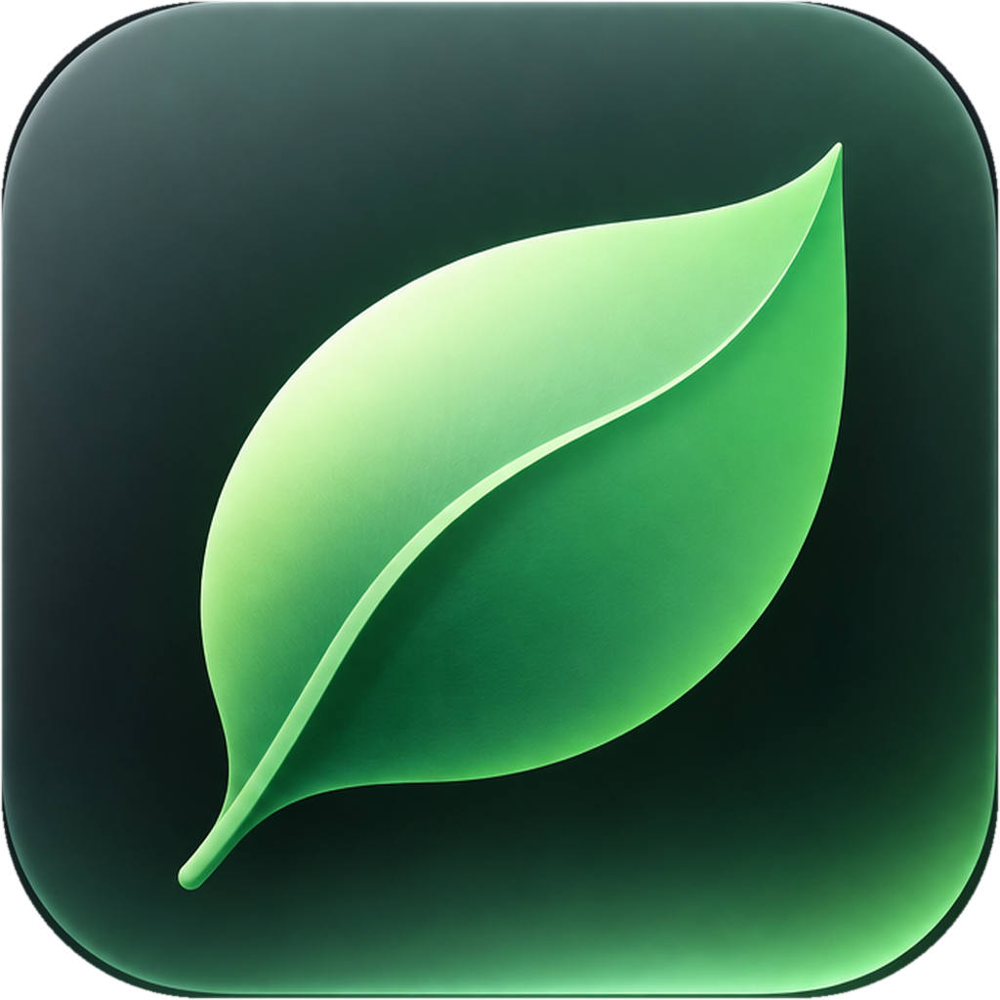
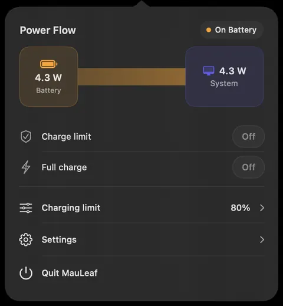
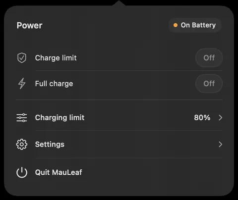
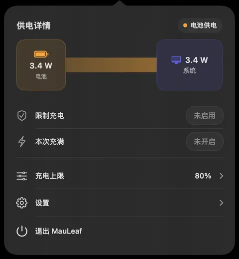
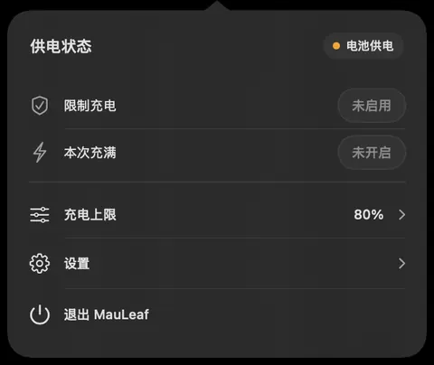

[简体中文](README.md) | [English](README.en.md)

  

<h1 align="center">MauLeaf</h1>

Open-source, lightweight macOS battery charge limiter for MacBook

  
  
  

  <a href="https://github.com/MauriceLiang/MauLeaf/releases/latest">Download stable release</a> ·
  <a href="https://github.com/MauriceLiang/MauLeaf/issues/new?template=bug_report.md">Report a problem</a> ·
  <a href="CHANGELOG.md">Changelog</a>

**MauLeaf** is a free, open-source **macOS battery charge limiter and battery care app for Apple Silicon MacBook**. Built with SwiftUI + AppKit and a native AppleSMC controller, it focuses on **charging limits** and **one-time full charge**. It lives in the menu bar as a green leaf, with no separate window or batt dependency. **Firmware writes currently support only one verified M1 Pro hardware profile**, as detailed below.

> [!NOTE]
> **MauLeaf v1.3.0**: App 1.3.0 / Helper 1.8.0 / XPC v9. Adds guarded MagSafe 3 LED control and a single dark appearance, with no appearance setting. Existing charge-limit, disconnect recovery and fast-quit behavior is retained. [Stable release notes](docs/releases/v1.3.0.md).

> [!CAUTION]
> **A stable release does not imply universal hardware support.** New firmware charging-limit writes are restricted to **MacBookPro18,1 (M1 Pro) + macOS 15 + mBoot-20457.41.3 + arm64**. macOS 26/27, Intel, and unverified devices cannot activate new limits. Battery viewing may still work on other devices. Actual charge-stop and resume percentages have not yet completed full physical validation; successful register read-back is not proof of real charging behavior.

## Screenshots

### English UI

| Power Flow | Compact Power Status |
| --- | --- |
|  |  |

### 中文界面

| 供电详情（展开模式） | 供电状态（简洁模式） |
| --- | --- |
|  |  |

Actual macOS dark-mode screenshots. Power Flow can be hidden while the supply-status badge stays visible.

## Quick links

| Goal | Where to go |
| --- | --- |
| Download the stable installer | [Latest GitHub Release](https://github.com/MauriceLiang/MauLeaf/releases/latest) |
| Check whether my Mac is supported | [Compatibility and safety](docs/COMPATIBILITY.md) |
| Explore features and controls | [Features and controls](#features-and-controls) |
| Report that it doesn't start or won't charge-limit | [Read-only diagnostics and bug report](#not-working-run-diagnostics-and-open-an-issue) |

### Helper version compatibility and uninstall

MauLeaf's privileged Helper has a build version and XPC protocol independent of the app release. Each launch checks protocol compatibility read-only. Compatible Helpers are reused without another administrator password after a UI-only update. An **installed incompatible Helper** triggers a user-authorized replacement attempt. First installation remains opt-in. Previous restoration snapshots and pending jobs are preserved. Exact bundled Helper version matching preserves recovery records during replacement.

The **Remove components on quit** setting defaults to Off. Normal quit hands a durable recovery job to the Helper, then exits without waiting. Off retains the installed components; On removes them in the background after verified recovery. No repeated normal-quit chooser appears. Enable removal before uninstalling. Any unsafe or unknown recovery state still blocks removal and preserves recovery data.

## Download and install

Get the **macOS Apple Silicon arm64 DMG** from the [latest stable Release](https://github.com/MauriceLiang/MauLeaf/releases/latest), then drag MauLeaf.app to Applications and open it.

The current package is **ad-hoc code-signed, without Apple Developer ID signing or notarization**. If macOS cannot verify the developer, first check that the installer came from this repository's official Release, then review available options in System Settings → Privacy & Security. Do not disable system security protections or run untrusted installers.

**Launch is read-only and does not request an administrator password, install the Helper, or enable charging limits.** You can see battery and power status and choose a local limit. Only when you explicitly click **Disabled** on the top charging-limit status row will MauLeaf request permission to install or update the privileged Helper if needed, then apply a guarded firmware change after confirmation.

## Features and controls

| Feature | Behavior |
| --- | --- |
| Power and live watts | Green menu-bar leaf; native adapter/system/battery power-flow diagram refreshes approximately every 2 seconds while visible; compact mode keeps only the supply-status badge |
| Charging limit | Click the top-card Disabled status to enable, or the active status to disable |
| Limit setting | 50–95% slider and 70 / 75 / 80 / 85 / 90 / 95% presets; settings are local only when disabled |
| One-time full charge | Start or cancel from the top card, available only while MauLeaf is managing an active limit |
| Dynamic Hold | Optional charge-holding policy when above the target; turning it off may delay unplug recognition on the tested Mac |
| Settings | Power details, Chinese/English interface, Dynamic Hold, Remove components on quit, and charging-control reset |
| Quit | Hand off durable recovery using the saved cleanup preference, then exit |

Before first activation, the privileged Helper snapshots the original bfF0, bfD0 and bfE0 values with device identity in a root-owned recovery file. Later limit changes or one-time full charge never overwrite the snapshot. Disabling a limit restores all original values with read-back verification; unknown states or failed restores are never reported as safe.

### Using MauLeaf with macOS Optimized Battery Charging

If you use a fixed charging limit in MauLeaf (for example, **85%**), **we recommend manually turning off macOS “Optimized Battery Charging”** so that MauLeaf is the primary charge-limit controller. macOS may learn your routine and delay charging above approximately 80%; with both features enabled, a battery may pause at 80% even when MauLeaf is set to 85%, and a **one-time full charge** may also be delayed by macOS. **This does not necessarily indicate a MauLeaf failure or a guaranteed conflict.**

- **When actively using MauLeaf charging limits:** You can turn off the option under **System Settings → Battery → Battery Health (or Battery Health Information) → Optimized Battery Charging**. The exact location varies by macOS version.
- **When you stop using MauLeaf charging limits:** Consider keeping or re-enabling macOS Optimized Battery Charging to let the system manage charging habits.
- **Optional, not required:** MauLeaf never changes that macOS setting automatically. Do **not** disable unrelated battery-health, temperature, or other system safety protections.

> [!NOTE]
> MauLeaf's physical charge-stop and resume thresholds still require extended on-device validation. Turning off macOS Optimized Battery Charging only reduces potential overlapping behavior; **it does not guarantee that MauLeaf will stop charging at the chosen percentage**.

### Quit and uninstall

| Remove components on quit | Behavior on every normal quit | Administrator password |
| --- | --- | --- |
| Off (default) | Restore and verify original firmware in the background; retain the Helper and launchd registration | Normally not required |
| On | Restore and verify in the background, then remove the Helper, LaunchDaemon and scripts; verify cleanup before deleting the app | Not required with the matching installed Helper |

On battery power alone, full restoration is allowed only when the validated identity and all additional checks pass (including independent power-source checks, battery at least 30%, and a valid original snapshot). **Failed restoration blocks component removal and retains recovery data.** Force Quit, crashes, and dragging the App to Trash directly cannot guarantee firmware restoration.

**Recommended uninstall:** Enable **Remove components on quit** in Settings, quit normally and confirm successful cleanup, then move MauLeaf.app to Trash. If you previously kept components and need manual recovery, run the bundled uninstaller *while MauLeaf.app still exists*:

~~~bash
sudo "/Applications/MauLeaf.app/Contents/Resources/MauLeafNativeControl/uninstall-native-firmware-helper.sh"
~~~

That is the **uninstaller**, not the password-free **diagnostic script** below. Never manually delete the root Helper or recovery snapshot before restoring firmware.

## Not working? Run diagnostics and open an Issue

If the menu-bar icon is missing, the limit control cannot be enabled, the Helper fails, authorization keeps appearing, firmware state shows unknown, or quitting fails, do not modify SMC registers or remove recovery files manually.

**Step 1: Download and run the repository's read-only diagnostic script in Terminal.**

~~~bash
curl -fL https://raw.githubusercontent.com/MauriceLiang/MauLeaf/main/Scripts/diagnose-mauleaf.sh -o MauLeaf-diagnose.sh
bash ./MauLeaf-diagnose.sh
~~~

If you have cloned the repository, you may instead run:

~~~bash
bash Scripts/diagnose-mauleaf.sh
~~~

The script reports macOS version, model identifier, firmware version, architecture, power/battery status, the standard installed app version/signature, and whether the Helper, LaunchDaemon, recovery directory and launchd service are visible. **It does not need sudo, change firmware or services, upload data, or collect serial numbers, usernames, IPs, passwords, full logs or recovery contents.** Root-protected files may be invisible to ordinary users; "not visible" does not prove they are absent.

**Step 2: [Open a bug Issue](https://github.com/MauriceLiang/MauLeaf/issues/new?template=bug_report.md)** and include:

1. The failure, reproduction steps, expected and actual behavior.
2. MauLeaf version and whether AC power is connected; redact screenshots of error dialogs if helpful.
3. The full terminal diagnostic output in the Issue template's diagnostic report section.

Review all content before posting: do not disclose passwords, device serials, personal paths, tokens, or private system logs. The diagnostic script is *not* a repair script; its report helps maintainers distinguish unsupported hardware, permission failures, and unavailable services.

[Inspect diagnostic source](Scripts/diagnose-mauleaf.sh) · [Browse existing Issues](https://github.com/MauriceLiang/MauLeaf/issues)

## Development and limitations

~~~bash
git clone https://github.com/MauriceLiang/MauLeaf.git
cd MauLeaf
bash tests/run.sh
~~~

Automated tests use a fake SMC backend and do not write actual battery firmware. CI produces and verifies Apple Silicon arm64 DMGs. New work must preserve explicit opt-in, minimal privilege, original-state snapshots, and fail-closed recovery.

- [Compatibility and safety limitations](docs/COMPATIBILITY.md)
- [Native firmware backend and safety](docs/NATIVE_FIRMWARE_BACKEND.md)
- [Charging behavior and known limits](docs/CHARGING.md)
- [Changelog](CHANGELOG.md)

## License

[Apache License 2.0](LICENSE), with the original ChargeCap [MIT notice](LICENSES/ChargeCap-Original-MIT.txt).
