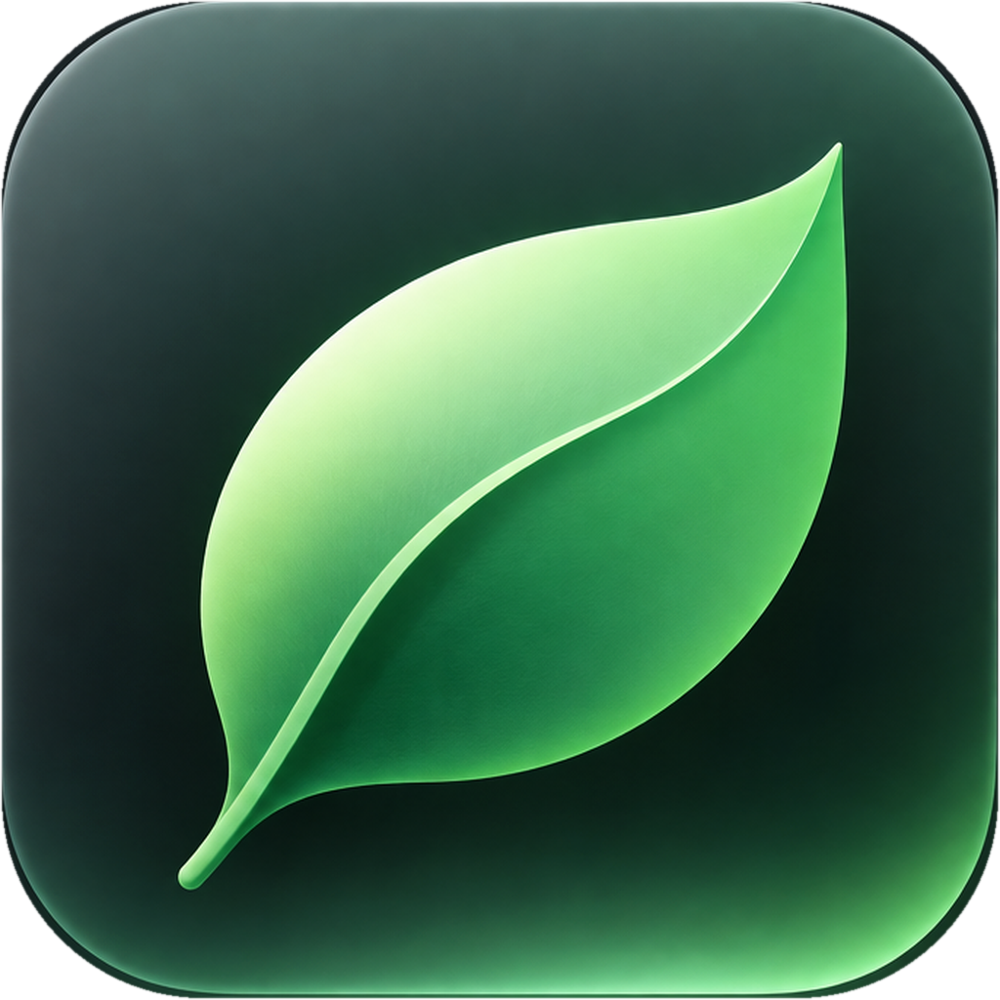

[简体中文](README.md) | [English](README.en.md)

<p align="center">
  
</p>

<h1 align="center">MauLeaf</h1>

<p align="center">轻量的 macOS 菜单栏充电管理工具</p>

<p align="center">
  <a href="https://github.com/MauriceLiang/MauLeaf/releases/latest">下载最新版本</a> ·
  <a href="CHANGELOG.md">更新日志</a> ·
  <a href="https://github.com/MauriceLiang/MauLeaf/issues">反馈问题</a>
</p>

MauLeaf 让长期接电使用的 Mac 可以按设定上限充电，也能在出门前临时充满。它驻留在菜单栏的一片叶子中，提供充电模式切换、电池功率查看和高电量处理，不必在终端反复输入命令。

应用使用 SwiftUI + AppKit 构建，通过随包附带的开源组件 [batt](https://github.com/charlie0129/batt) 执行底层充电控制。MauLeaf 原名 ChargeCap，从 v0.7.0 起统一使用新名称。

## 能做什么

| 功能 | 使用体验 |
| --- | --- |
| 设定充电上限 | 在 50–95% 之间调整；点击预设立即应用，滑块停止拖动后自动提交。 |
| 按需充满 | 选择「仅充满一次」，满电后恢复原上限；也可持续允许充至 100%。 |
| 处理高电量 | 超过上限时保持适配器供电，或主动使用电池降至上限；支持该能力的设备才可开启后者。 |
| 查看电池功率 | 同时展示充电与放电功率；面板展开时自适应刷新，收起后停止额外功率采样。 |
| 登录时自动启动 | 用户自行开启或关闭，默认不注册；状态与系统登录项保持一致。 |
| 一键切换语言 | 面板底部点击「English」或「中文」即时切换，自动保存选择。 |
| 简洁的菜单栏交互 | 单色或绿色叶子图标，点击外部收起面板；操作提示悬浮在底部，避免挤动控件。 |
| 正常退出解除控制 | 退出前恢复供电并解除限充，确认成功后关闭；下次启动重新应用保存的设置。 |
| 图形化安装与卸载 | 内置固定版本组件，首次安装通过系统授权完成；提供独立卸载器。 |

主动降电量具有合盖、温度异常、安全读数失效和超时保护。单次充满结束后会暂停主动降电量，避免刚充满就立即消耗电池。具体行为见 [充电行为与运行边界](docs/CHARGING.md)。

## 系统要求

- Apple Silicon Mac（arm64），macOS 13 或更高版本。
- 首次安装系统控制组件需要管理员授权；日常操作通过已安装的服务执行。
- 可用的充电与适配器控制能力以 batt 在设备上实际报告的结果为准。当前不提供 Intel 安装包。

## 安装

1. 在 [GitHub Releases](https://github.com/MauriceLiang/MauLeaf/releases/latest) 下载 `MauLeaf-<版本>.dmg`。同页提供更新内容和 SHA-256 校验文件。
2. 打开 DMG，将 `MauLeaf.app` 拖入 `Applications` 后启动。安装包另含 `Uninstall MauLeaf.app`。
3. 点击菜单栏叶子打开面板。若尚未安装控制组件，点击「一键安装内置组件」，按系统提示完成管理员授权。运行时无需另行下载 batt。
4. 选择充电模式和目标上限，操作结果会在底部提示。应用启动和面板打开时自动更新状态。
5. 默认使用中文；点击面板底部的「English」切换为英文，再点击「中文」切回。语言选择会保留到下次启动。

当前安装包使用本地 ad-hoc 签名，尚未进行 Apple notarization，macOS 可能阻止首次打开。确认下载来源后，可在系统设置「隐私与安全性」中按系统提示允许打开。

已有 Homebrew 或其他来源的 batt 时，MauLeaf 不会直接覆盖它；服务不可用或权限不足时会显示错误，请先处理原有安装。

### 从 ChargeCap 升级

先正常退出旧版 ChargeCap，再用 MauLeaf 替换原应用。已有设置、管理凭据与正常工作的 batt 服务继续复用，无需重新安装组件。确认新应用运行正常后，可移除旧 `ChargeCap.app`；请勿同时运行两个版本。

部分内部标识与数据目录保留旧名称以兼容升级，详见 [兼容约定](docs/CHARGING.md#从-chargecap-升级的兼容约定)。

## 日常使用

- **长期接电**：选择「控制模式」并设置上限。电量已经超过上限时，默认保持适配器供电，等待电量自然下降。
- **准备外出**：选择「直接充满 → 仅充满一次」。达到 100% 后恢复先前的限充值，也可随时取消。
- **持续需要满电**：选择「直接充满 → 持续允许充满」；回到控制模式后恢复保存的上限。
- **希望主动降至上限**：在控制模式中选择对应策略。达到目标或触发保护条件后恢复适配器供电；暂停后可手动恢复。

电量圆环中心用闪电表示正在充电、插头表示接电但未充电、与应用图标同向的叶子轮廓表示使用电池。低电量模式仍通过圆环颜色和状态文字提示。

面板展开时，充放电约每 2 秒更新功率，空闲约每 5 秒。收起面板停止额外采样，后台状态检查和安全监控继续工作。功率来自电池侧读数，**不是充电器输入功率**；系统未提供有效数据时显示「—」。

**收起面板和退出应用是不同操作。** 正常退出会等待正在执行的操作、停止任务并验证解除控制；若失败，应用会保留错误提示，可再次尝试退出。batt 服务保持安装，但处于不限充状态。

### 登录时自动启动

在菜单栏图标样式下方开启或关闭「登录时自动启动」。首次使用默认关闭，不会自动注册；如果系统中已有注册，则显示系统记录的状态。建议先将应用安装到 `Applications` 再开启。

该选项在用户登录 Mac 后启动应用；正常退出不会清除这个选择。若提示等待系统允许，点击「管理登录项」进入系统设置，允许 MauLeaf 后才会生效。也可以随时关闭开关取消注册。从系统设置返回应用时会重新读取状态。

实现使用 macOS 原生 [SMAppService 登录项接口](https://developer.apple.com/documentation/servicemanagement/smappservice)。

## 卸载

如已开启自启动，先关闭「登录时自动启动」，再正常退出 MauLeaf，运行安装包内的 `Uninstall MauLeaf.app`。卸载器会先尝试恢复默认充电控制，再清理由本应用管理的组件、任务、设置及 `/Applications` 内的新旧主应用，完成后可删除卸载器。外部来源的 batt 不会被删除。

仅想移除控制组件时，也可使用主面板内的「卸载组件」，保留 MauLeaf 应用。

## 运行边界

- 强制结束进程、崩溃或断电可能绕过正常退出清理，持久的限充设置可能保留。可重新启动应用后正常退出以解除控制。
- 「仅充满一次」使用固定版本 batt 的限时解除配合约 20 秒后台检查实现；睡眠期间不能保证到达 100% 时立刻恢复，另有 10 小时限时恢复兜底。
- 主动降电量依赖系统与控制服务运行。合盖停供可能使外接屏模式进入睡眠；睡眠或服务停止时，定时恢复不保证实时执行。
- 自动化检查覆盖逻辑与离屏布局；真实硬件充放电、正常退出、插拔电源、睡眠和长期能耗仍需进一步验收。完整说明见 [技术参考](docs/CHARGING.md)。

## 本地开发

需要 Apple Silicon Mac、Xcode Command Line Tools 和 Python 3。首次构建需要联网获取固定版本的官方 batt，后续可复用 `Vendor` 中的本地缓存。

```bash
git clone https://github.com/MauriceLiang/MauLeaf.git
cd MauLeaf
./tests/run.sh
./build.command
```

产物位于 `build/`：`MauLeaf.app`、`Uninstall MauLeaf.app` 和 `MauLeaf-<版本>.dmg`。两个应用均内嵌叶子图标和许可证。版本号与构建号统一维护于 `build.command`。

测试使用模拟控制组件，不执行真实硬件控制命令；涵盖模式切换、上限恢复、保护与退出流程、自适应采样及提示不挤动布局等行为。

| 目录 | 内容 |
| --- | --- |
| `Sources/` | 主应用、充电逻辑与独立后台检查器 |
| `Assets/` | 应用图标与菜单栏资源 |
| `tests/` | 逻辑、模拟后端与离屏布局回归 |
| `Vendor/` | 固定组件版本与第三方许可证 |
| `docs/` | 运行说明、图标说明与发布记录 |

文档：[充电行为](docs/CHARGING.md) · [构建与发布](docs/RELEASING.md) · [图标说明](docs/ICON_GUIDE.md)。欢迎通过 Issue 提供 macOS 版本、芯片型号、应用版本、复现步骤和错误详情；提交前请移除个人信息。

## 许可证与致谢

MauLeaf 采用 [Apache License 2.0](LICENSE)。项目保留原始 ChargeCap 的 [MIT 声明](LICENSES/ChargeCap-Original-MIT.txt)。

感谢 [charlie0129/batt](https://github.com/charlie0129/batt) 提供底层控制能力。内置组件固定为 `v0.8.0`，作为独立 CLI 调用，遵循其 [GPL-2.0 许可证](Vendor/BATT-LICENSE.txt)；对应版本源码归档随 Release 提供。项目许可证不改变该组件的许可证。
