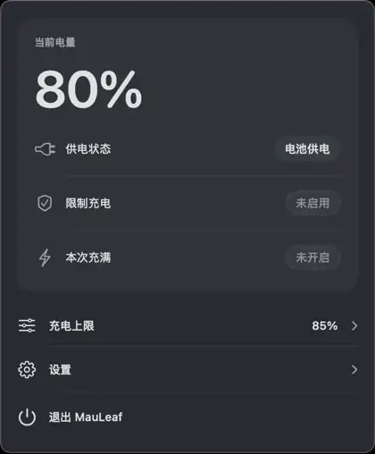
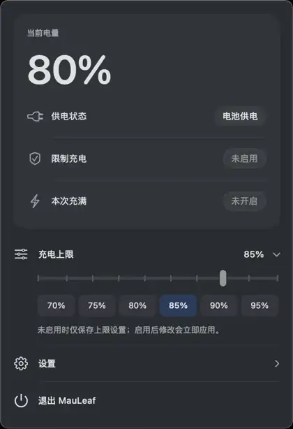

> **Preview 6 拔电恢复：** 连接电源并启用限充后，拔掉充电器会触发**真实的原始 SMC 参数恢复**（不是仅隐藏限充状态）。只有 Helper 完成逐项读回，才显示已恢复；如电量过低或状态不安全，则保留快照及后台恢复任务。重新插电后，仅在用户此前主动启用且恢复已完成时，待电源稳定再自动恢复限充；手动关闭和正常退出不会自动启用。详见 [Preview 6 更新说明](docs/releases/v0.9.1-preview.6.md)。macOS 自身识别物理断电可能延迟数秒，此功能无法提前于系统可靠断电信号执行。

> **重启后固件状态恢复（Preview 5）**：如果启动时固件报告关闭状态 `bfF0=0`、上下限 `0/0`，MauLeaf 会将其识别为待就绪状态，不再直接提示 Helper 损坏。存在可信原始快照的已授权限充可在电源稳定后尝试恢复原先目标；无快照绝不自动写入，所有异常活动寄存器仍严格阻断。见 [更新说明](docs/releases/v0.9.1-preview.5.md)。

[简体中文](README.md) | [English](README.en.md)

  

<h1 align="center">MauLeaf</h1>

免费开源、轻量原生的 macOS 菜单栏电池充电限制工具

  
  
  

  <a href="https://github.com/MauriceLiang/MauLeaf/releases/latest">下载正式版</a> ·
  <a href="https://github.com/MauriceLiang/MauLeaf/issues/new?template=bug_report.md">报告问题</a> ·
  <a href="CHANGELOG.md">更新日志</a>

**MauLeaf** 是一款免费的开源 **MacBook 电池充电管理 / macOS battery charge limiter**，基于 SwiftUI + AppKit 与自研 AppleSMC 控制器。它专注于 **充电上限**和**本次充满**：常驻菜单栏、绿色叶子图标、无需独立主窗口，不依赖 batt。

> [!NOTE]
> **Preview 3 电源状态响应修复：** 拔插电源后改为由 IOKit 事件触发更新，并使用快速原生电池读取；仍保留低频轮询兜底。该变化只影响供电状态显示，不会主动切换适配器供电。参见 [Preview 3 说明](docs/releases/v0.9.1-preview.3.md)。

> [!IMPORTANT]
> **0.9.1-preview.1 实验功能：超限优先适配器（仅检测）。** 设置中新增可开启的超限状态观察，读取电池电流并提示持续放电。**此预览版不会改变供电路径，也不能阻止超过上限时的放电。** 详情：[技术验证边界](docs/ABOVE_LIMIT_POWER.md) · [预览版说明](docs/releases/v0.9.1-preview.1.md)。

> [!CAUTION]
> **正式版不等于通用硬件兼容。** 当前新建充电限制只允许 **MacBookPro18,1（M1 Pro）+ macOS 15 + mBoot-20457.41.3 + arm64**。macOS 26/27、Intel 和其他未经验证的设备不能开启新的固件限充。其他环境可以尝试查看电量，但不应期待限充可用。实际停止/恢复充电的百分比仍需要完整真机验证；寄存器读回成功不代表充电行为已经完全验证。

## 应用预览

  
  

深色模式真实界面 · 左：状态总览 · 右：充电上限展开。示例中限充处于未启用状态。

English screenshots: [Overview](docs/screenshots/en-overview.webp) · [Charging-limit controls](docs/screenshots/en-limit-expanded.webp)

## 快速入口

| 我想要… | 入口 |
| --- | --- |
| 下载正式版安装包 | [GitHub 最新正式 Release](https://github.com/MauriceLiang/MauLeaf/releases/latest) |
| 先确认我的 Mac 是否能用 | [兼容性与安全限制](docs/COMPATIBILITY.md) |
| 了解功能和具体操作 | [下方功能与操作](#功能与操作) |
| 下载后打不开或限制无法启用 | [只读诊断与故障 Issue](#无法使用运行诊断脚本并提交-issue) |

### Helper 版本管理与卸载

MauLeaf 的应用版本与特权 Helper 版本独立。每次启动只读检查 XPC 协议是否兼容：兼容时沿用已安装的 Helper，升级界面不会重复要求管理员密码；仅在**已安装旧 Helper 不兼容**时，才申请一次管理员授权升级。首次安装仍由用户主动开启限充触发。升级会保留原始固件快照和恢复任务，失败时尝试恢复旧版可用组件。未知的新协议不会被旧应用自动降级。

无论 App 是否只更新了界面，**移除组件并退出**都使用同一安全卸载流程：先验证固件已恢复，再验证已安装 Helper 的代码签名、root 所有权和服务身份，最后清理 LaunchDaemon 及自身系统文件；不再比较旧 Helper 与新应用内置文件的二进制内容。若未知旧版服务无法完成恢复验证，保留恢复组件，不能强制删除。详情见 [Preview 2 更新说明](docs/releases/v0.9.1-preview.2.md)。

## 下载与安装

从 [最新正式版 Release](https://github.com/MauriceLiang/MauLeaf/releases/latest) 下载 **macOS Apple Silicon arm64 DMG**，打开后将 MauLeaf.app 拖入「应用程序」，再启动应用。

本项目当前使用 **ad-hoc 代码签名，尚未进行 Apple Developer ID 签名与公证**。如果 macOS 提示无法验证开发者，请先确认下载来源为本仓库官方 Release，再到「系统设置 → 隐私与安全性」查看系统是否提供允许打开的选项；不建议关闭系统安全保护或使用不明安装脚本。

**启动不需要管理员密码，也不会自动安装 Helper 或开启限制充电。** 可以直接查看电量、供电状态并预先选择充电上限。首次主动点击「限制充电」右侧的「未启用」后，应用才按需请求安装/更新特权 Helper 所需的管理员授权，并在用户确认后执行受保护的固件写入。

## 功能与操作

| 功能 | 当前行为 |
| --- | --- |
| 电量与供电状态 | 菜单栏绿色叶子；弹出面板显示电量及供电状态 |
| 限制充电 | 点击顶部状态卡的「未启用」开启；再次点击已启用状态关闭 |
| 充电上限 | 50–95% 滑杆，70 / 75 / 80 / 85 / 90 / 95% 预设；未启用时仅保存设置 |
| 本次充满 | 点击顶部状态卡开始或取消；仅在 MauLeaf 已启用限充时可开始 |
| 设置 | 在弹出面板内切换简体中文 / English |
| 退出 | 可选择保留或移除系统控制组件，先验证原始固件恢复 |

首次启用限充前，Helper 会将 bfF0、bfD0、bfE0 的原始值和设备身份保存到 root 拥有的恢复快照。修改充电上限或执行「本次充满」不会覆盖这份原始快照。关闭限充时会恢复三个原始值并读回验证；状态不明或恢复失败时不会假装成功。

### 与 macOS「优化电池充电」一起使用

如果你在 MauLeaf 中设置了固定的充电上限（例如 **85%**），**建议手动关闭 macOS 自带的「优化电池充电」**，让充电上限由 MauLeaf 单独管理。macOS 会根据使用习惯决定是否在约 80% 暂缓继续充电；两者同时开启时，即使 MauLeaf 设置为 85%，电池也可能先停在 80%，「本次充满」也可能受到系统延迟充电影响。**这不一定代表 MauLeaf 发生故障，也不意味着两者必然冲突。**

- **启用 MauLeaf 固定限充时：** 可以在「系统设置 → 电池 → 电池健康（或电池健康信息）→ 优化电池充电」中手动关闭。不同 macOS 版本的设置入口可能略有不同。
- **没有使用 MauLeaf 限充时：** 建议保留或重新开启 macOS「优化电池充电」，由系统根据使用习惯管理充电。
- **不是强制条件：** MauLeaf 不会自动修改该系统开关，也不要求关闭电池健康管理、温度保护或其他系统安全机制。

> [!NOTE]
> MauLeaf 的实际充电停止和恢复阈值仍需要进一步真机验证。关闭 macOS「优化电池充电」只是减少策略叠加的干扰，**不能保证 MauLeaf 必然在设定百分比停止充电**。

### 退出与卸载

| 选项 | 行为 | 管理员密码 |
| --- | --- | --- |
| 保留组件并退出 | 恢复并验证原始固件；保留 launchd 服务注册，Helper 空闲后自动退出，下次启动可直接复用 | 正常情况下不需要 |
| 移除组件并退出 | 恢复并验证原始固件；删除已安装的 Helper、LaunchDaemon 和相关恢复组件；App 本身仍需在 Finder 删除 | 删除系统组件时需要 |
| 取消 | 返回应用，不执行退出清理 | 不需要 |

未插电时，只有满足已验证的设备身份、双重电源检测、电量至少 30%、原始快照等全部条件，才允许精确恢复。**恢复失败时会阻止正常退出/清理并保留恢复数据。** 强制退出、应用崩溃或直接将 App 扔进废纸篓，都不保证执行固件恢复。

如果已经选择「保留组件并退出」，随后需要彻底卸载，可在 App 尚未被删除时运行仓库提供的卸载脚本：

~~~bash
sudo "/Applications/MauLeaf.app/Contents/Resources/MauLeafNativeControl/uninstall-native-firmware-helper.sh"
~~~

这条命令用于**卸载**，与下文完全不需要 sudo 的**诊断脚本**不同。不要在尚未恢复固件时手动删除 Helper 或 root-owned 快照。

## 无法使用？运行诊断脚本并提交 Issue

如果遇到打开后没有菜单栏图标、无法启用充电限制、状态显示「未知」、Helper 安装失败、授权反复弹出、退出恢复失败等问题，请不要直接修改 SMC 寄存器或删除系统恢复文件。

**第一步：在终端下载并运行仓库自带的只读诊断脚本。**

~~~bash
curl -fL https://raw.githubusercontent.com/MauriceLiang/MauLeaf/main/Scripts/diagnose-mauleaf.sh -o MauLeaf-diagnose.sh
bash ./MauLeaf-diagnose.sh
~~~

也可克隆仓库后执行：

~~~bash
bash Scripts/diagnose-mauleaf.sh
~~~

脚本只显示 macOS 版本、机型、系统固件版本、架构、电源/电量、标准安装位置的 App 版本与签名结果、Helper/LaunchDaemon/恢复目录是否可见，以及 launchd 注册状态。**不需要 sudo，不进行固件读写、不修改任何系统服务、不联网提交结果；不采集序列号、用户名、IP、密码、完整系统日志或快照内容。** root 保护文件可能无法被普通用户查看，因此「不可见」不代表文件不存在。

**第二步：[创建故障 Issue](https://github.com/MauriceLiang/MauLeaf/issues/new?template=bug_report.md)。** 请提供：

1. 具体遇到的问题、复现步骤，以及预期和实际结果。
2. 使用的 MauLeaf 版本、操作时是否连接电源；如有错误提示，可附脱敏截图。
3. 将终端打印的完整诊断报告复制到 Issue 模板的「诊断输出」栏。

提交前请再次检查输出与截图，不要公开管理员密码、设备序列号、个人路径、令牌或包含隐私的系统日志。诊断脚本不是修复脚本；结果用于确认兼容性、授权及服务状态，方便维护者定位问题。

[查看诊断脚本源码](Scripts/diagnose-mauleaf.sh) · [查看已有 Issues](https://github.com/MauriceLiang/MauLeaf/issues)

## 开发与限制

~~~bash
git clone https://github.com/MauriceLiang/MauLeaf.git
cd MauLeaf
bash tests/run.sh
~~~

自动化测试使用模拟 SMC，不会写入真实硬件。发布仅构建 arm64 DMG，CI 负责校验文件；新版本开发遵循明确启用、最小权限、原始快照和失败保留的保护原则。

- 已验证系统与机型：[兼容性及安全限制](docs/COMPATIBILITY.md)
- 固件实现与安全边界：[Native firmware backend](docs/NATIVE_FIRMWARE_BACKEND.md)
- 充电行为与已知限制：[Charging behavior](docs/CHARGING.md)
- 历史变更：[CHANGELOG.md](CHANGELOG.md)

## 许可证

[Apache License 2.0](LICENSE)，保留原 ChargeCap 的 [MIT 声明](LICENSES/ChargeCap-Original-MIT.txt)。
