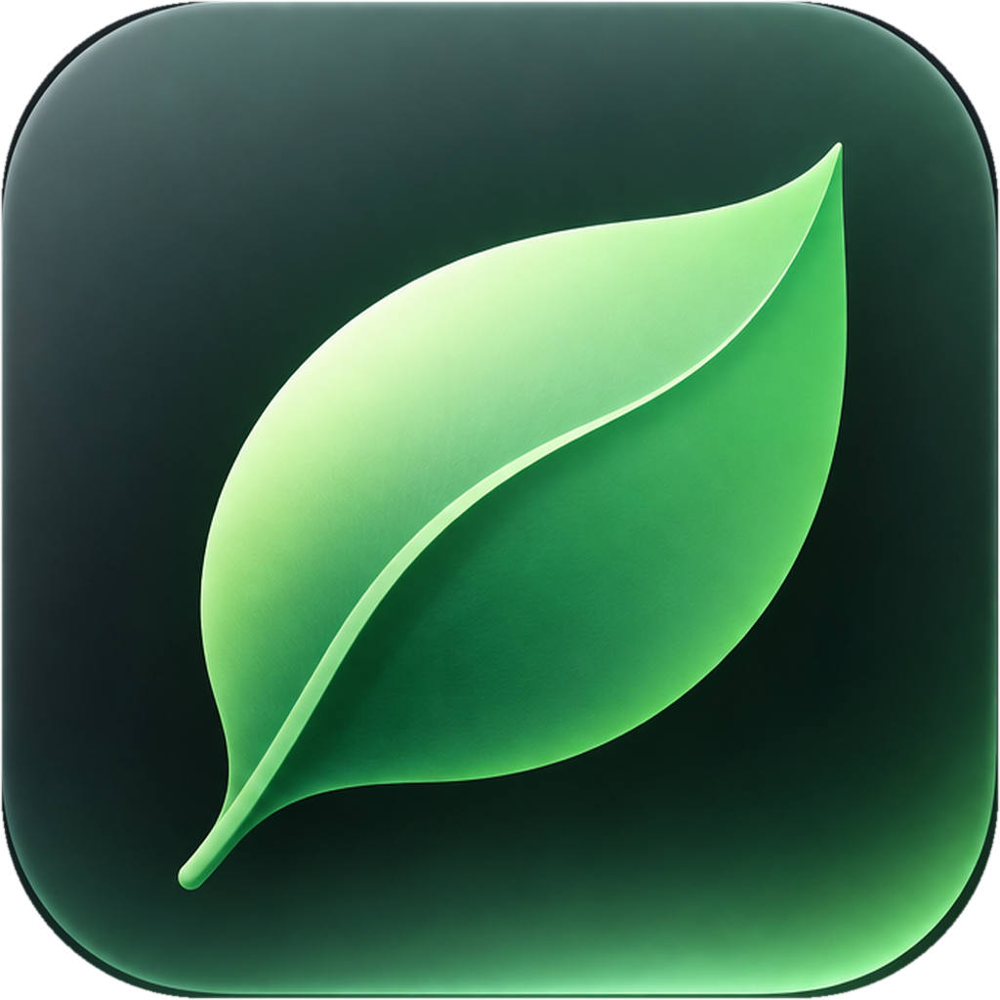

[简体中文](README.md) | [English](README.en.md)

> [!CAUTION]
> **当前原生预览版仅面向 Apple Silicon、macOS 15 和已验证的 MacBookPro18,1 / mBoot-20457.41.3 硬件配置。Intel 不再提供构建；macOS 26/27 和其他未经验证的环境不支持新建充电限制。已有原始快照的恢复操作会单独进行硬件身份校验。**

<p align="center">
  
</p>

<h1 align="center">MauLeaf</h1>

<p align="center">轻量、原生的 macOS 菜单栏充电控制工具</p>

<p align="center">
  <a href="https://github.com/MauriceLiang/MauLeaf/releases">下载 Preview</a> ·
  <a href="CHANGELOG.md">更新日志</a> ·
  <a href="https://github.com/MauriceLiang/MauLeaf/issues">反馈问题</a>
</p>

MauLeaf 只保留日常充电上限和「本次充满」两项功能。**不创建独立主窗口**：点击菜单栏固定的绿色叶子，即可查看紧凑弹出面板。顶部显示大号当前电量与供电、限充、本次充满三项状态；「限制充电」与「本次充满」右侧状态胶囊可直接点击开启或关闭，供电状态仅用于查看。点击「充电上限」在面板内仅展开滑杆与快捷预设（不重复显示启用按钮）；「设置」在面板内展开语言切换，底部可以正常退出。

本预览版使用 MauLeaf 自研 AppleSMC 控制器和随应用打包的原生特权服务，不包含 batt 二进制、第三方固件资源或第三方控制调用。

## 功能

| 功能 | 说明 |
| --- | --- |
| 主动启用限充 | 首次启动默认不写入限制；用户点击「启用限制充电」后才保存原始固件状态并启用 |
| 充电上限 | 50–95%，支持滑杆和 70/75/80/85/90/95% 快捷预设；未启用时只保存本地设置 |
| 关闭限充 | 恢复启用前保存的 bfF0、bfD0、bfE0 原始值，逐项读回验证后删除快照 |
| 本次充满 | 临时关闭当前限充；达到 100%、手动取消或 10 小时期限后恢复当前限充 |
| 电池状态 | 显示当前电量和供电状态 |
| 菜单栏 | 固定绿色叶子，不显示百分比，不提供样式切换 |

没有实时功率卡片、主动放电、持续充满、登录项设置或第三方控制组件安装页面。

## 原始固件状态与卸载安全

第一次启用限充时，root helper 会先读取三个寄存器，并将原始值、设备型号、系统固件和架构保存到：

    /Library/Application Support/MauLeaf/original-firmware-state.json

快照由 root 拥有，权限为 0600，独立于应用安装目录。修改充电上限不会覆盖这份原始快照。

- 点击「关闭限制充电」：先关闭限充，再恢复原始上限、恢复阈值和原始激活状态，逐项读回一致后才删除快照。
- **完全卸载**：先退出 MauLeaf，运行应用包内的卸载脚本。Helper 在有电源或经过真机验证的无电源状态下精确恢复原始 bfF0、bfD0、bfE0；再次验证为已关闭且无待恢复任务后，自动删除应用、Helper、LaunchDaemon、持久恢复文件与所有随应用提供的脚本。
- **无电源恢复与卸载**：仅在已通过真机验证的 MacBookPro18,1、mBoot-20457.41.3、macOS 15、arm64 上开启。离线恢复额外要求 IOKit 与 pmset 都确认使用电池、电量 ≥30%、没有正在充电、原始快照有效且原始 bfF0 为 0x00。所有条件满足时立即恢复；任何条件不明、写入失败或读回不符，都保留 App、Helper、快照，不会宣称卸载成功。
- 系统升级：恢复操作仅允许相同机型、相同系统固件和相同 Apple Silicon 架构；即使新系统版本不允许启用新限充，仍可尝试恢复已保存的原始状态。

**Preview 4 及更早版本没有保存首次启用前的原始阈值。** 升级后若检测到没有快照但限充仍处于启用状态，MauLeaf 会明确提示。停用旧版状态只能清除激活标志并保留当前阈值，无法重建未保存的历史值。若之后再次启用 Preview 5，当前保留的阈值会被作为新的快照基线；它代表当前可读取状态，不等于真正的 Preview 4 之前原始值。

## 硬件范围与安全边界

当前已验证的写入目标：

- 机型：MacBookPro18,1（Apple M1 Pro）
- 系统：macOS 15
- 固件：mBoot-20457.41.3
- 架构：arm64
- 控制寄存器：AppleSMC 的 bfF0、bfD0、bfE0

新建或修改充电限制前会检查机型、固件、系统版本、寄存器元数据、电源连接和用户确认；写入后逐项读回校验，失败时尝试恢复此前状态。未连接电源或硬件条件不匹配时，不会执行新的限充写入。

> [!IMPORTANT]
> 目标 M1 Pro 的实际充电停止点和恢复点仍需接电实测。寄存器写入并读回成功，不等于已经证明电池会在设定百分比停止充电。请把本版本视为硬件验证预览版，不要依赖它承担未经验证的关键电池管理任务。

首次启动时，应用会自动请求一次管理员授权，以安装 MauLeaf 自己的 AppleSMC 特权服务。服务由本仓库源码构建，不提供通用 SMC 写入接口。

## 安装

1. 从 [GitHub Releases](https://github.com/MauriceLiang/MauLeaf/releases) 下载 MauLeaf-<版本>-macos-arm64.dmg。
2. 将 MauLeaf.app 拖入「应用程序」并启动。
3. 首次启动时，按 macOS 提示授权安装 MauLeaf 原生固件服务。
4. 选择充电上限，连接电源后点击「启用限制充电」。

仅提供 Apple Silicon arm64 安装包。Intel 不再构建或发布。

## 日常使用

- **未启用时**：调整滑杆或快捷预设只会保存本地上限，不会写入固件。
- **启用限制充电**：点击顶部状态卡「限制充电」右侧的「未启用」按钮。首次硬件写入需要明确确认，helper 会先保存原始快照。
- **修改上限**：限充启用后，滑杆和预设会立即应用新上限，但不会覆盖原始快照。
- **关闭限制充电**：点击顶部状态卡「限制充电」右侧的已启用状态按钮，恢复启用前的三个寄存器值。旧版限充停用和待恢复重试也从同一处操作。
- **本次充满**：点击顶部状态卡「本次充满」右侧按钮开始或取消。仅在 MauLeaf 限充已启用时可开始；充满任务结束后恢复当前 MauLeaf 上限，之后仍可手动关闭限充并恢复最初快照。
- **正常退出应用**：出现「保留组件并退出 / 移除组件并退出 / 取消」选项。无论选择保留还是移除，都立即尝试恢复并验证原始固件配置，再按用户选择停止 Helper 或彻底删除系统控制组件。固件或清理失败时取消正常退出，保留必要文件并提供明确诊断。

## macOS 正常退出：是否保留控制组件

点击菜单栏「退出」时，MauLeaf 显示「退出时是否保留控制组件？」并提供三项选择：

| 退出选择 | 立即恢复原始 bfF0/bfD0/bfE0 | 停止后台 Helper | 系统级 Helper 与脚本 | App |
| --- | --- | --- | --- | --- |
| **保留组件并退出** | 逐项验证 | 停止 | 保留供下次启动使用 | 保留 |
| **移除组件并退出** | 逐项验证 | 停止 | 删除 Helper、LaunchDaemon、恢复记录、安装在系统目录的脚本和日志 | 保留，用户在 Finder 移入废纸篓 |
| **取消** | 不退出 | 不额外清理 | 不变 | 保留 |

任一正常退出选项都会先恢复启用限充前保存的原始固件配置，在验证完成后才停止/删除后台组件。**插电和已验证的电池供电条件都可以立即恢复**。若固件恢复失败、权限不足、服务停止失败、系统级文件删除失败，正常退出被取消并明确报告；请返回应用解决问题后重试。仅作为紧急兜底提供「仍然退出」，它并不保证恢复或清理成功。

选择「保留组件并退出」后，后台进程退出，文件和 LaunchDaemon 配置保留，下次打开 MauLeaf 会重新启用 Helper（macOS 可能要求再次管理员授权）。

选择「移除组件并退出」后，系统级组件已移除，但应用自身不会在运行过程中删除文件。**用户在退出成功后，将 `/Applications/MauLeaf.app` 拖入废纸篓即可；应用包内的安装和卸载脚本随 App 一并删除**。

macOS Finder 直接移动 App 到废纸篓不会触发以上固件恢复/服务移除流程。强制退出、崩溃、突然断电同样无法保证执行退出回调；应保留异常恢复能力。

## 备用：终端完整卸载

如果应用已经正常退出，但之前选择了保留组件，可在应用仍位于「应用程序」时运行：

```bash
sudo "/Applications/MauLeaf.app/Contents/Resources/MauLeafNativeControl/uninstall-native-firmware-helper.sh"
```

命令会再次验证固件限充关闭、无待恢复任务，删除系统级原生服务与脚本，最后删除 App。对于原始快照仍存在的情况，必须先完整恢复并验证全部寄存器；没有保存历史原始值的旧版限充不能被声称为精确还原。

## 本地开发与测试

    git clone https://github.com/MauriceLiang/MauLeaf.git
    cd MauLeaf
    bash tests/run.sh

自动化测试使用内存中的模拟 SMC transport，不会对真实硬件写入。Release 由 GitHub Actions 构建，Preview 标签格式为 vX.Y.Z-preview.N。

## 项目结构

| 目录 | 内容 |
| --- | --- |
| Sources/ | SwiftUI 菜单栏应用、AppleSMC 事务控制器、XPC 特权服务 |
| Support/ | 原生 LaunchDaemon 配置 |
| Scripts/ | 原生服务安装、卸载和 CI 打包脚本 |
| Tools/ | 只读硬件探测及独立验证工具 |
| tests/ | 固件事务、快照恢复、服务和界面回归测试 |
| docs/ | 硬件边界、充电行为与发布说明 |

## 许可证

MauLeaf 使用 [Apache License 2.0](LICENSE)，并保留原 ChargeCap 的 [MIT 声明](LICENSES/ChargeCap-Original-MIT.txt)。当前预览版不捆绑第三方充电控制程序或其固件资源。
